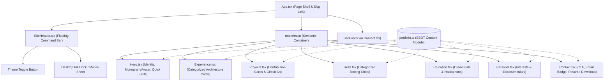
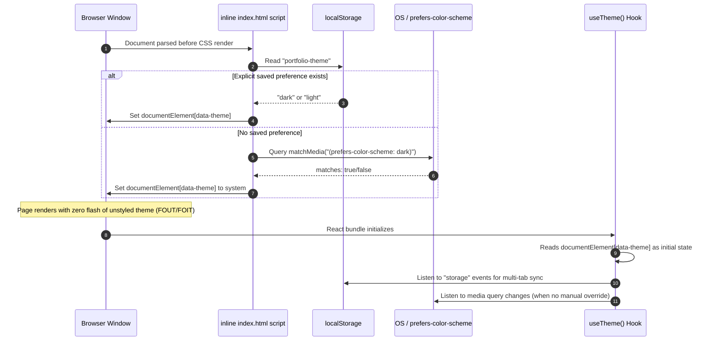

# System Architecture & Design Philosophy

This document outlines the architecture, component hierarchy, design token engine, and accessibility contracts governing the **Soojan Basu Developer Portfolio** (`RESUME2`).

---

## 1. Architectural Principles

The portfolio is built following strict engineering constraints to ensure speed, accessibility, and zero runtime surprises:

* **Zero External Network Dependencies**: No Google Fonts, external CDNs, tracker scripts, or unvetted third-party assets. All assets (fonts, SVGs, PDF resume) are self-hosted and bundled locally.
* **Strict Performance Budgets**:
  * Decoded JavaScript bundle: **$\le$ 250 KiB**
  * Decoded CSS stylesheet: **$\le$ 35 KiB**
  * Page load third-party requests: **0**
* **DRY + KISS without Over-Abstraction**: Business logic and presentation are kept lean. Avoid redundant state containers, generic repository abstractions, or heavyweight CSS frameworks.
* **Single Source of Truth (SSOT)**: All resume facts, dates, roles, deliverables, and projects reside in [`src/content/portfolio.ts`](../src/content/portfolio.ts). Components consume this data directly; no resume data is hardcoded inside components.

---

## 2. Component Hierarchy & Data Flow



---

## 3. Theme Engine & Zero-Flash Hydration

Theme selection supports both automatic system preference detection and explicit visitor choice with cross-tab persistence.



### Storage Resilience (`useTheme.ts`)
If a browser blocks `localStorage` (e.g. strict private browsing or `QuotaExceededError`), the hook catches the exception gracefully. An explicit selection persists in-memory for the duration of the visit without throwing or reverting to an outdated state.

---

## 4. The HSL Design Token System

The entire color architecture is anchored in two tunable HSL hue numbers in [`src/index.css`](../src/index.css):

```css
:root {
  --hue-blue: 216;   /* Deep Blue / Indigo anchor */
  --hue-green: 168;  /* Cyan / Mint accent anchor */
}
```

Every surface, border, gradient, glow, and hover state is procedurally derived from these base hues:

| Token | Dark Mode Calculation | Light Mode Calculation | Purpose |
| :--- | :--- | :--- | :--- |
| `--bg` | `hsl(216, 50%, 7%)` | `hsl(216, 20%, 89%)` | Background surface (calming silver-slate in light mode, no harsh glare) |
| `--surface` | `hsl(216, 44%, 12%)` | `hsl(216, 24%, 94%)` | Primary card panels |
| `--surface-soft` | `hsl(216, 38%, 16%)` | `hsl(216, 20%, 85%)` | Sub-panels, pill badges, and form controls |
| `--text` | `hsl(216, 100%, 96%)` | `hsl(216, 48%, 12%)` | High-contrast body typography ($\ge 11:1$ contrast) |
| `--muted` | `hsl(216, 30%, 75%)` | `hsl(216, 20%, 34%)` | Secondary metadata ($\ge 5.2:1$ contrast) |
| `--cyan` / `--blue` | Saturated glow accents | Deep editorial jewel tones | Interactive highlights, borders, and focus rings |

---

## 5. Accessibility & Navigation Contracts

1. **Skip Navigation**: Accessible hidden skip link (`.skip-link`) at the top of the DOM jumps keyboard focus directly to `#main` when Tab is pressed.
2. **Focus Management**:
   * Sections have `tabIndex={-1}` so programmatic anchor jumps move focus without adding confusing extra tab stops.
   * Mobile menu traps focus: pressing `Escape` immediately closes the menu and restores focus to the menu toggle button.
3. **WCAG Compliance**: Tested against **WCAG 2.1 Level AA and AAA** rules via `@axe-core/playwright` across both 375px mobile and 1440px desktop viewports in both dark and light modes.
4. **Motion Preference**: Full support for `@media (prefers-reduced-motion: reduce)`. All animations and smooth scrolling automatically deactivate for visitors with vestibular sensitivities.
