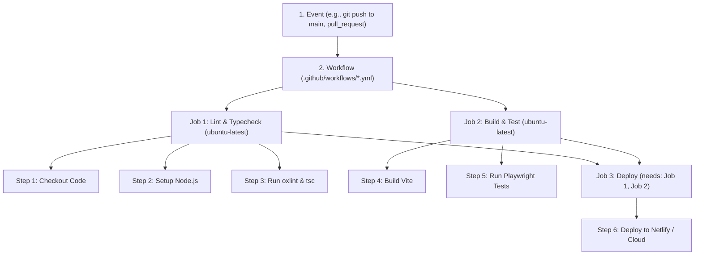

# Mastering GitHub Actions: CI/CD Engineering Guide

This guide is a complete, practical handbook on **GitHub Actions** and **Continuous Integration / Continuous Deployment (CI/CD)**. It covers everything from fundamental mental models to production pipeline architectures tailored for this portfolio.

---

## 1. What is GitHub Actions & Why Does It Matter?

In modern software engineering, writing code is only half the battle. You also need to ensure:
* Code doesn't break existing functionality before merging.
* Code passes linting, formatting, and strict type checks.
* The application compiles without exceeding bundle size budgets.
* Tests run automatically on every Pull Request (Continuous Integration - **CI**).
* Passing code is deployed directly to production without manual FTP/SSH uploads (Continuous Deployment - **CD**).

**GitHub Actions** is GitHub's built-in automation and CI/CD platform. It lets you automate tasks directly within your GitHub repository triggered by any GitHub event (like pushing code, opening a PR, creating a release, or on a recurring cron schedule).

---

## 2. Core Concepts & Architecture



### The 5 Building Blocks

| Concept | What It Is | Practical Example |
| :--- | :--- | :--- |
| **Workflow** | An automated configurable process made of one or more jobs, written in a YAML file inside `.github/workflows/`. | `ci.yml`, `deploy.yml` |
| **Event / Trigger** | A specific activity that triggers the workflow to run. | `push`, `pull_request`, `workflow_dispatch` (manual button click) |
| **Job** | A set of steps executed on the same runner virtual machine. By default, jobs run in **parallel**; use `needs:` to run them sequentially. | `lint-and-typecheck`, `e2e-test`, `deploy` |
| **Step** | An individual task within a job. Can run a shell command or execute a pre-packaged Action. | `run: npm run lint`, `uses: actions/checkout@v4` |
| **Runner** | The virtual server that executes your workflow. GitHub provides hosted Linux, Windows, and macOS VMs. | `runs-on: ubuntu-latest` |

---

## 3. Production Workflows for This Portfolio

### Workflow 1: Continuous Integration Pipeline (`ci.yml`)

Save this file in `.github/workflows/ci.yml`. This workflow runs on every push and pull request to verify that no breaking changes reach `main`.

```yaml
name: CI Quality Gate

# Trigger on push to main or testing, and on all Pull Requests
on:
  push:
    branches: [main, testing]
  pull_request:
    branches: [main]
  # Allows manual triggering from GitHub UI
  workflow_dispatch:

# Cancel in-progress runs for the same branch/PR if a new commit is pushed
concurrency:
  group: ${{ github.workflow }}-${{ github.ref }}
  cancel-in-progress: true

jobs:
  # -------------------------------------------------------------
  # Job 1: Static Analysis & Type Checking
  # -------------------------------------------------------------
  quality:
    name: Lint & Typecheck
    runs-on: ubuntu-latest
    steps:
      - name: Check out repository
        uses: actions/checkout@v4

      - name: Setup Node.js 24 LTS
        uses: actions/setup-node@v4
        with:
          node-version: 24
          cache: 'npm' # Caches ~/.npm to speed up subsequent runs significantly

      - name: Install dependencies
        run: npm ci

      - name: Run Oxlint (Linter)
        run: npm run lint

      - name: Run TypeScript Typecheck
        run: npm run typecheck

  # -------------------------------------------------------------
  # Job 2: Production Build & Performance Budgets
  # -------------------------------------------------------------
  build:
    name: Build & Verify Bundles
    runs-on: ubuntu-latest
    needs: quality # Only runs if linting & typing succeed
    steps:
      - name: Check out repository
        uses: actions/checkout@v4

      - name: Setup Node.js 24 LTS
        uses: actions/setup-node@v4
        with:
          node-version: 24
          cache: 'npm'

      - name: Install dependencies
        run: npm ci

      - name: Compile production bundle
        run: npm run build

      - name: Verify Bundle Size Budgets
        run: |
          echo "Verifying compiled asset sizes..."
          CSS_SIZE=$(wc -c < dist/assets/*.css)
          JS_SIZE=$(wc -c < dist/assets/*.js)
          echo "CSS Decoded Bytes: $CSS_SIZE (Budget: 35840 bytes / 35 KiB)"
          echo "JS Decoded Bytes:  $JS_SIZE (Budget: 256000 bytes / 250 KiB)"
          if [ "$CSS_SIZE" -gt 35840 ]; then
            echo "ERROR: CSS exceeds 35 KiB budget!"
            exit 1
          fi
          if [ "$JS_SIZE" -gt 256000 ]; then
            echo "ERROR: JS exceeds 250 KiB budget!"
            exit 1
          fi
          echo "All bundle budgets satisfied!"

      - name: Upload build artifact
        uses: actions/upload-artifact@v4
        with:
          name: production-dist
          path: dist/
          retention-days: 7
```

---

### Workflow 2: Automated Deployment to Netlify / GitHub Pages (`deploy.yml`)

If you want GitHub Actions to build and deploy directly to Netlify or GitHub Pages on every push to `main`:

```yaml
name: Deploy to Production

on:
  push:
    branches: [main]

jobs:
  deploy:
    name: Deploy to Netlify
    runs-on: ubuntu-latest
    steps:
      - name: Check out repository
        uses: actions/checkout@v4

      - name: Setup Node.js
        uses: actions/setup-node@v4
        with:
          node-version: 24
          cache: 'npm'

      - name: Install dependencies & Build
        run: |
          npm ci
          npm run build

      - name: Deploy to Netlify
        uses: nwtgck/actions-netlify@v3.0
        with:
          publish-dir: './dist'
          production-branch: main
          github-token: ${{ secrets.GITHUB_TOKEN }}
          deploy-message: "Deploy from GitHub Actions commit ${{ github.sha }}"
        env:
          NETLIFY_AUTH_TOKEN: ${{ secrets.NETLIFY_AUTH_TOKEN }}
          NETLIFY_SITE_ID: ${{ secrets.NETLIFY_SITE_ID }}
```

---

## 4. Key Advanced Features Every Engineer Should Know

### 1. Caching Dependencies
Downloading `node_modules` on every run wastes minutes. Using `actions/setup-node` with `cache: 'npm'` automatically hashes your `package-lock.json` and restores dependencies from GitHub's internal cache in seconds:
```yaml
- uses: actions/setup-node@v4
  with:
    node-version: 24
    cache: 'npm'
```

### 2. Managing Concurrency
When a developer pushes 3 commits in rapid succession to a pull request, you don't want 3 duplicate workflows running simultaneously and burning billable minutes. Concurrency groups cancel stale runs:
```yaml
concurrency:
  group: ${{ github.workflow }}-${{ github.ref }}
  cancel-in-progress: true
```

### 3. Secrets & Environment Variables
Never commit API keys, tokens, or credentials into repository files. Store them under **Repository Settings $\rightarrow$ Secrets and variables $\rightarrow$ Actions**.
Access them in YAML with:
```yaml
env:
  API_KEY: ${{ secrets.MY_SECRET_KEY }}
```

### 4. Matrix Builds (Multi-Environment Testing)
If you want to test whether your application works on Node 20, Node 22, and Node 24 simultaneously across Ubuntu, macOS, and Windows:
```yaml
strategy:
  matrix:
    node-version: [20, 22, 24]
    os: [ubuntu-latest, macos-latest]
runs-on: ${{ matrix.os }}
```

---

## 5. Interview Talking Points (Add to Your Skillset)

When interviewers ask about your DevOps or CI/CD experience, here is how you can discuss this:

> *"In my projects, I use GitHub Actions to establish automated quality gates on every Pull Request. I structure multi-stage pipelines that run fast static analysis first (using tools like Oxlint and TypeScript compiler), followed by production asset bundling, bundle size budget enforcement, and end-to-end browser tests in headless environments before authorizing merges into main.*
>
> *I also optimize pipeline execution time by leveraging npm caching, concurrency cancellation for superseded commits, and secure secret injection for automated cloud edge deployments to Netlify."*
